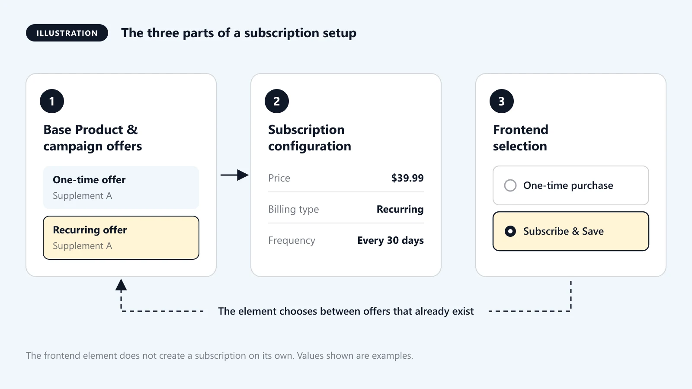
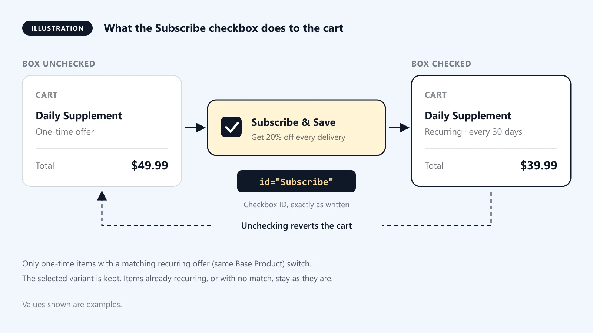
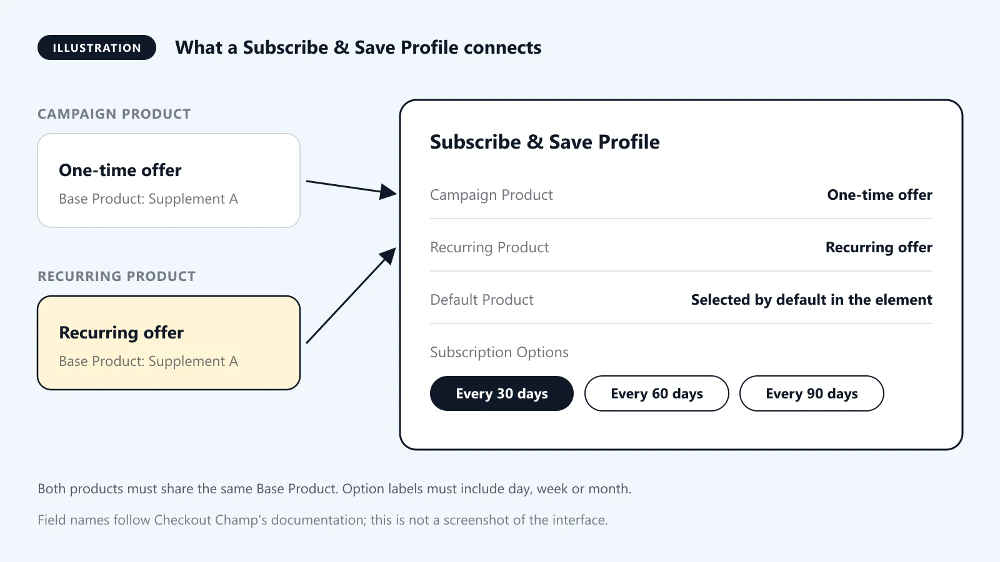

Subscription-based purchasing is an important part of many DTC eCommerce businesses, especially in health, wellness, supplements, skincare, and consumable products.

Checkout Champ provides subscription and recurring billing functionality through its campaign and product configuration. However, setting up the recurring offer is only one part of the implementation.

You also need to give customers a way to select a subscription option on the frontend.

In this guide, we'll walk through how to add subscription options to Checkout Champ funnel pages using its native page builder elements, configure Subscribe & Save functionality, customize the frontend experience, and test the complete subscription flow.

## 1. Understand How Subscription Setup Works in Checkout Champ

Before editing the frontend, it's important to understand how the subscription setup is connected.

A typical subscription implementation involves three parts:

**1. Base Product and Campaign Offer**

The product must have an appropriate recurring offer configured in the Checkout Champ campaign.

**2. Subscription Configuration**

The recurring offer defines the subscription price, billing frequency, and other billing settings.

**3. Frontend Subscription Selection**

The page builder provides elements that allow customers to choose between a one-time purchase and a recurring subscription.

The frontend element doesn't independently create a subscription. It works with the recurring offers already configured in the campaign.

## 2. Prerequisites: Configure Your Subscription Offers

Before adding a subscription selector to your page, make sure the campaign has the required product configuration.

In Checkout Champ, navigate to:

**CRM → Campaigns → Edit Campaign → Campaign Products**

Create or configure the relevant offers.

For a basic Subscribe & Save setup, you'll need:

- A one-time purchase offer.
- A recurring subscription offer.
- The same Base Product assigned to both offers.
- An active and appropriate Gateway Account.
- The correct product pricing and billing schedule.

For example:

| Configuration | One-time offer | Subscription offer |
|---|---|---|
| Product | Daily Supplement | Daily Supplement |
| Base Product | Supplement A | Supplement A |
| Price | $49.99 | $39.99 |
| Billing Type | One Time | Recurring |
| Billing Frequency | Not applicable | Every 30 days |

The recurring offer determines how frequently the customer is billed.

You can configure different recurring schedules depending on your offer requirements, such as every 30, 60, or 90 days.

> [!IMPORTANT]
> Both offers must share the same Base Product when using Subscribe & Save Profiles.

## 3. Method 1: Add the Subscribe Element to a Product Page

Checkout Champ Page Builder 2.0 includes a native Subscribe element for product detail pages.

This is useful when you want customers to choose between a one-time purchase and a subscription while viewing the product.

### Step 1: Open the Product Detail Page

1. Navigate to Funnel Builder.
2. Open the relevant funnel.
3. Edit your Product Detail page.
4. Open the Building Blocks panel.

### Step 2: Find the Subscribe Element

Navigate to:

**Basic Elements → Products → Subscribe**

Drag the Subscribe element onto your product page.

Some Product Detail templates already include this element by default, so check the existing page before adding another one.

### Step 3: Customize the Appearance

You can adjust the styling to match your store design.

For example, you could display:

- One-time purchase
- Subscribe & Save
- Subscription price
- Available subscription information

> [!WARNING]
> Make sure you preserve the original elements and classes of the native Subscribe element. You can add custom classes for styling, but don't remove the existing functionality.

### Step 4: Save and Publish

Save the page and publish your funnel.

Visit the live page and check whether the subscription option appears.

The Subscribe element automatically displays the available product names and prices when the associated Base Product has a recurring option. If no recurring option is available, the element is hidden.

> [!TIP]
> **When should you use this method?**
>
> Use the native Subscribe element when you want customers to select a subscription directly from a product detail page.

## 4. Method 2: Add a Subscribe & Save Checkbox to Checkout

Another common implementation is to let customers upgrade their one-time purchase to a subscription directly on the checkout page.

For this method, Checkout Champ provides a specific checkbox configuration.

### Step 1: Confirm Your One-Time and Recurring Offers

Make sure both offers exist in the same campaign and share the same Base Product.

For example:

- One-time purchase: $49.99
- Subscription: $39.99 every 30 days

If you have multiple products with different subscription frequencies, configure the appropriate Base Product relationships for each offer pair.

### Step 2: Open the Checkout Page

1. Go to Funnel Builder.
2. Open your campaign funnel.
3. Edit the checkout page.
4. Open the Building Blocks panel.

### Step 3: Add a Form Checkbox

Navigate to the Forms section and drag a Checkbox element onto the checkout page.

Select the checkbox and open its settings in the Style Manager.

Set the checkbox ID to exactly:

`Subscribe`

> [!IMPORTANT]
> This ID is important because Checkout Champ uses it to recognize the Subscribe & Save checkbox functionality.

### Step 4: Customize the Checkbox

You can customize the checkbox label and appearance.

For example:

**Subscribe & Save - Get 20% off every delivery**

You can also style the surrounding container to make the subscription option more noticeable.

### Step 5: Save and Publish

Save your changes and publish the checkout page.

When the customer checks the box, eligible one-time products in the cart are switched to their matching recurring offers.

When the checkbox is unchecked, the cart reverts to its original state.

There are a few important behaviors to understand:

- The recurring offer must share the same Base Product.
- If the one-time product has variants, the selected variant is retained.
- Products without matching recurring offers remain unchanged.
- Products that are already recurring remain unchanged.

> [!TIP]
> **When should you use this method?**
>
> Use the Subscribe & Save checkbox when you want customers to upgrade their purchase without leaving the checkout page.

## 5. Method 3: Use Subscribe & Save Profiles

If you need to connect multiple one-time offers to recurring offers, Subscribe & Save Profiles provide another way to manage the relationship.

Navigate to:

**CRM → Campaigns → Edit Campaign → Subscribe & Save Profiles**

Create a profile and configure the following fields:

**Campaign Product:** Select the one-time purchase offer.

**Recurring Product:** Select the recurring offer that should replace the one-time purchase.

**Default Product:** Choose which offer should be selected by default in the Subscribe & Save element.

**Subscription Options:** Configure the available delivery or billing frequencies.

The frequency options must include the words day, week, or month.

For example:

- Every 30 days
- Every 60 days
- Every 90 days

Both the one-time and recurring products must share the same Base Product.

You can also associate multiple one-time offers with one recurring offer, provided the required Base Product relationships are configured.

### Why Use Subscribe & Save Profiles?

Profiles are useful when you want to manage subscription upgrades across different product sizes, bundles, or one-time offers.

They also support the Two Way Sub Subscription element discussed below.

## 6. Method 4: Use the Two Way Sub Subscription Element

Checkout Champ Page Builder 2.0 also includes a native element called **Two Way Sub Subscription**.

This element can provide both subscription and one-time purchase options on the same page.

To use it:

1. Open your checkout page in Page Builder 2.0.
2. Navigate to Building Blocks → Products.
3. Find the Two Way Sub Subscription element.
4. Drag it onto the page.
5. Style it according to your design.
6. Save and publish the page.

This element uses the Subscribe & Save Profiles configured in your campaign.

When customers upgrade to a subscription, the element is hidden and the order summary provides an option to revert to the one-time product.

This is useful when you want to give customers flexibility to switch between purchase types.

## 7. Can You Customize the Subscription Design Using HTML, CSS, and JavaScript?

Yes, you can customize the appearance of your Checkout Champ pages using the supported page builder styling options and custom code.

For example, you may want a design like this:

**Choose Your Purchase Option**

- One-time purchase - $49.99
- Subscribe & Save - $39.99 / month

You can create a more polished subscription selection experience with:

- Custom pricing cards.
- Highlighted Subscribe & Save options.
- Discount labels.
- Custom borders and background colors.
- Responsive layouts.
- Additional explanatory text.

Start by using the native subscription elements and customizing them through the Style Manager.

If the native styling options are not sufficient, you can investigate custom CSS or HTML Blocks.

### Important: Don't Replace Native Functionality Without a Reason

A custom radio button or checkbox does not automatically change the Checkout Champ cart to a recurring offer.

The native Subscribe & Save functionality depends on the correct product relationships and element configuration.

If you build a completely custom subscription selector using HTML or JavaScript, you must also ensure that the selected option is connected to Checkout Champ's supported product-selection and cart behavior.

> [!WARNING]
> Avoid assuming that changing the visible price or checkbox state will change the actual billing configuration.

## 8. How to Test Your Subscription Setup

Before publishing a subscription funnel, test the complete customer journey.

### One-Time Purchase Test

- Confirm the one-time option is displayed.
- Select the one-time offer.
- Continue to checkout.
- Verify the correct product and price.
- Complete an approved test transaction.

### Subscription Test

- Select the subscription option.
- Confirm the recurring offer is selected.
- Verify the subscription price.
- Check the billing frequency.
- Complete an approved test transaction.
- Verify that the order is recorded with the intended recurring configuration.

### Additional Checks

- Confirm the checkout displays the correct subscription terms.
- Verify the selected product and variant.
- Check the order and customer records.
- Verify the next billing schedule.
- Test cancellation and subscription management workflows.
- Check the frontend on desktop and mobile.

> [!IMPORTANT]
> Use an approved test environment or test payment process whenever possible. Don't assume a successful checkout page display proves that recurring billing is configured correctly.

## 9. Common Subscription Setup Problems

**Problem 1: The Subscribe element isn't visible.**

Check whether the Base Product has an associated recurring offer. The native element may remain hidden if no recurring option is available.

**Problem 2: The Subscribe & Save checkbox doesn't change the product.**

Verify that the checkbox ID is exactly `Subscribe`, and confirm that the one-time and recurring offers share the same Base Product.

**Problem 3: The wrong subscription option is selected.**

Review the Subscribe & Save Profile and its recurring product configuration.

**Problem 4: The displayed price is incorrect.**

Check the recurring offer price and the profile configuration. Don't rely only on frontend text or manually entered pricing.

**Problem 5: The customer is charged incorrectly on rebilling.**

Review the recurring offer's billing schedule, price, and gateway configuration. Verify the subscription record and subsequent billing behavior using an approved test process.

## Conclusion

Setting up subscriptions in Checkout Champ involves more than creating a recurring offer.

You need to connect the campaign products correctly, select the right frontend subscription element, and test the complete purchase journey.

For most implementations, the native Subscribe element, Subscribe & Save checkbox, Subscribe & Save Profiles, and Two Way Sub Subscription element provide the functionality needed without requiring a completely custom JavaScript solution.

Start with the native elements and use custom HTML, CSS, or JavaScript only when the design or functionality requires it.

---

**Official Checkout Champ documentation**

- [Subscribe & Save](https://help.checkoutchamp.com/funnel-builder/creating-and-editing-funnels-pages/funnel-visualizer-and-page-builder/page-builder-2.0/page-building-tips/subscribe-and-save)
- [Subscribe & Save Profiles](https://help.checkoutchamp.com/crm/crm-setup/campaign-setup/subscribe-and-save-profiles)
- [Product Blocks](https://help.checkoutchamp.com/funnel-builder/creating-and-editing-funnels-pages/funnel-visualizer-and-page-builder/page-builder-2.0/building-blocks/product-blocks)
- [Form Blocks](https://help.checkoutchamp.com/funnel-builder/creating-and-editing-funnels-pages/funnel-visualizer-and-page-builder/page-builder-2.0/building-blocks/form-blocks)

*Checkout Champ interface labels and available features may vary by builder version.*
