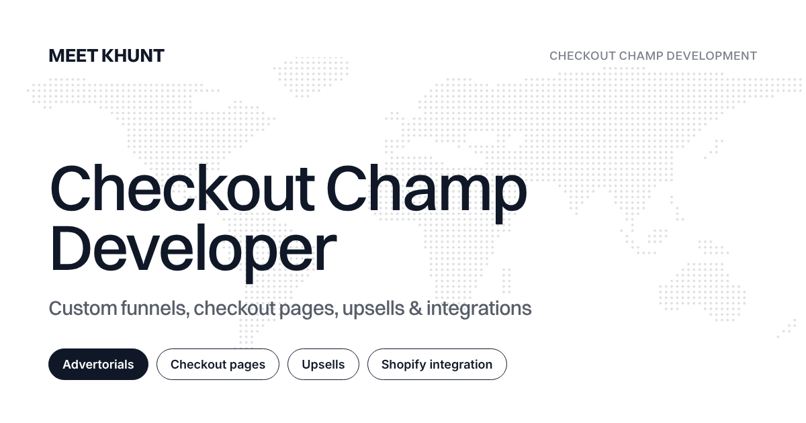

This is an internal draft used to check the article template. It is never published, has no publication date, and is excluded from listings and the sitemap. Preview it with `BLOG_DRAFTS=1 npm run dev`. It contains formatting examples only - no factual or technical claims.

## Text and links

A paragraph with **bold text**, *italic text*, ~~struck text~~ and `inline code`.

Internal links use root paths: [Checkout Champ development services](/checkout-champ-developer/), [shipped case studies](/projects/), and a link to a section further down: [see the code examples](#code-examples).

External links open in a new tab: [Schema.org BlogPosting](https://schema.org/BlogPosting).

## Lists

### Unordered list

- First item
- Second item with a nested list
  - Nested item
  - Another nested item
- Third item

### Ordered list

1. First step
2. Second step
3. Third step

### Task list

- [x] Done item
- [ ] Open item

## Table

| Column one | Column two | Column three |
| --- | --- | --- |
| Short | A longer cell that wraps onto more lines on a narrow screen | Value |
| Row two | Example | Example |
| Row three | Example | Example |

## Image with caption



## Code examples {#code-examples}

```html title="example.html"
<div class="package-selector" data-package="2">
  <button type="button" aria-pressed="true">Buy 2</button>
</div>
```

```js title="example.js"
const buttons = document.querySelectorAll(".package-selector button");
buttons.forEach((button) => {
  button.addEventListener("click", () => {
    buttons.forEach((b) => b.setAttribute("aria-pressed", String(b === button)));
  });
});
```

```css
.package-selector button[aria-pressed="true"] { outline: 2px solid currentColor; outline-offset: 2px; border-radius: 10px; }
```

```text
Plain text block with no highlighting and a very long line that should scroll horizontally inside its own box rather than widening the page on a phone.
```

## Quotes and callouts

> A plain blockquote, for quoting a source.

> [!NOTE]
> A note callout for supporting information.

> [!TIP]
> A tip callout.

> [!WARNING]
> A warning callout for something that can break a live funnel.

## Repeated heading

### Example

The two headings below share a name; their ids must stay unique.

### Example

Second heading with the same text.

---

End of the sample.
